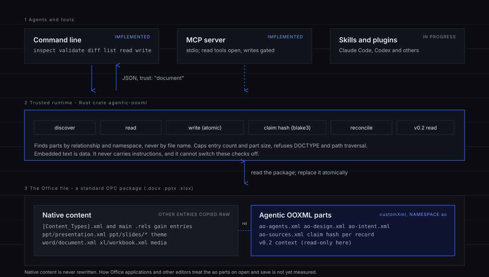

# Agentic OOXML

**Let an agent edit the board deck. Know when a number moved.**

[](LICENSE)

Who a deck is for, where each figure came from and what must not change are stored **inside the
`.pptx`, `.docx` or `.xlsx` itself**. The next edit starts with that context, and a number that moved
gets flagged instead of silently trusted. **[See it on the project site](https://orquentra-inc.github.io/Agentic-ooxml/)**,
with a live demo of a stale number being caught.

```bash
curl -fsSL https://raw.githubusercontent.com/Orquentra-Inc/Agentic-ooxml/main/scripts/install.sh | sh
```

Linux and macOS, no Rust needed; it installs `agentic-ooxml` and `agentic-ooxml-mcp` into `~/.local/bin`
after checking the release checksum. Windows, Cargo and Claude Code routes are under [Install](#install).

- **The file notices when a number moves.** Edit the workbook cell a slide quotes and the deck's source
  reports `stale` (`external_claim_changed`), though the deck was never touched. Real output:
  [examples/demo-output.txt](examples/demo-output.txt).
- **Your original is safe by default.** Through MCP, writes are off unless `AGENTIC_OOXML_ALLOW_WRITE=1`,
  produce a sibling `.ao-proposed` copy, and stay inside `AGENTIC_OOXML_ROOTS`. Native package entries are copied byte for byte.
- **Every edit is reviewable, and it stays local.** `diff` and `validate` show what changed and whether the package
  is sound; the core, CLI and MCP crates have no network dependency. Open source (MIT).

Agentic OOXML stores the context an agent needs to edit an Office file correctly, such as who it is
for, how it should look, and where its numbers came from, as standard OOXML custom XML parts. A Rust library and
command line read and write those parts, and report when a sourced number has changed since someone checked it.
It never copies the document's own structure, so there is no second copy to drift. It does not edit slides,
cells or paragraphs, and it does not check that your numbers are right.



## Status

**Early release, version 0.1. Open source (MIT). Not on crates.io or npm.** The code and docs are in
this repository, and nothing here claims more than the tests show. Install options are [below](#install).

| works today | not yet |
|---|---|
| `inspect`, `validate`, `diff`, `list`, `read`, `write`, `sources`, `reconcile` on `.docx`, `.pptx`, `.xlsx` | typed design tokens, a `validation` part, an agent registry (all **proposed**) |
| `agents`, `design`, `intent` parts (Markdown sections) and `sources` (claim hashes, staleness) | any measurement in Microsoft Office, LibreOffice, ONLYOFFICE or Google |
| read-only v0.2 context (`doc`, `units`, `spec`) | evidence that it improves agent results |
| atomic writes; safety caps on ZIP and XML | agent integrations verified end to end (in progress) |
| an MCP server (stdio) with writes off by default | |

Read the [roadmap](ROADMAP.md) for what is implemented, in progress, proposed and research.

## Install

Agentic OOXML is an **early release (version 0.1)**. It is **not on crates.io or npm**, and there are
no packages for any other registry. Pick one of the routes below. Round trips through Microsoft
Office, LibreOffice, ONLYOFFICE and Google are **unmeasured** (see [Compatibility](docs/compatibility.md)).

**A. From source** (needs a Rust toolchain). `cargo install` accepts only one `--path`, so this is two commands:

```bash
git clone https://github.com/Orquentra-Inc/Agentic-ooxml
cd Agentic-ooxml
cargo install --path crates/agentic-ooxml-cli
cargo install --path crates/agentic-ooxml-mcp
agentic-ooxml --version
```

Or straight from GitHub, without a checkout (one command, both binaries):

```bash
cargo install --git https://github.com/Orquentra-Inc/Agentic-ooxml agentic-ooxml-cli agentic-ooxml-mcp
```

Both put `agentic-ooxml` and `agentic-ooxml-mcp` in `~/.cargo/bin`. To work inside a checkout without
installing, use `cargo build --release` and put `target/release` on your `PATH`.

**B. Prebuilt binaries** from [GitHub Releases](https://github.com/Orquentra-Inc/Agentic-ooxml/releases)
(v0.1.0): Linux x86_64, macOS arm64 and x86_64, Windows x86_64, each with a
`SHA256SUMS` file. They are not signed. On Linux and macOS the install script downloads the right
archive, verifies its checksum and installs into `~/.local/bin`:

```bash
curl -fsSL https://raw.githubusercontent.com/Orquentra-Inc/Agentic-ooxml/main/scripts/install.sh | sh
```

(Read [scripts/install.sh](scripts/install.sh) first if you do not run scripts from the internet blindly.
`AO_VERSION=v0.1.0` pins a release.) On other platforms, use route A.

**C. Claude Code plugin**, which adds the skills and an MCP server entry. The plugin does not bundle
the `agentic-ooxml-mcp` binary: install it with route A or B first.

```bash
claude plugin marketplace add Orquentra-Inc/Agentic-ooxml
claude plugin install agentic-ooxml@agentic-ooxml
```

Inside a Claude Code session the same commands are `/plugin marketplace add Orquentra-Inc/Agentic-ooxml`
and `/plugin install agentic-ooxml@agentic-ooxml`. Details: [integrations/claude-code](integrations/claude-code/README.md).

## First example

Make a sample deck, write intent and a source claim into it, change the number, and watch the claim go stale.
The helper scripts use only Python's standard library.

```bash
mkdir -p target/ao-demo
python3 docs/guides/make-minimal-deck.py target/ao-demo/deck.pptx

cat > target/ao-demo/sources.json <<'JSON'
{ "sources": [ {
  "id": "src-q4-forecast", "status": "verified", "source_kind": "workbook",
  "resource_uri": "relative:Financial_Model.xlsx", "location": "Forecast!D12",
  "claim_part": "ppt/slides/slide1.xml", "claim_object_id": "3"
} ] }
JSON
agentic-ooxml write --file target/ao-demo/deck.pptx --kind sources --input target/ao-demo/sources.json

python3 docs/guides/edit-forecast.py target/ao-demo/deck.pptx 21.3 23.0   # someone edits the number
agentic-ooxml sources --file target/ao-demo/deck.pptx
```

The last command prints the record with `"effective_status": "stale"` and `"stale_reason": "claim_changed"`.
`agentic-ooxml reconcile --file target/ao-demo/deck.pptx` writes that finding into the file, and
`agentic-ooxml validate --file target/ao-demo/deck.pptx` checks the package structure and warns about stale sources.
The [full walk-through](docs/getting-started.md) also writes intent and reads it back one section at a time.

Ready-made synthetic files are in [examples/](examples/): `board-deck.pptx`, `financial-model.xlsx` and
`report.docx`. `scripts/demo.sh` runs a before-and-after session on them, and its real output is committed as
[examples/demo-output.txt](examples/demo-output.txt). Nothing in `examples/` has been opened in Microsoft Office.

## What it adds

| part | what it carries | status |
|---|---|---|
| `intent` | audience, purpose, narrative, what each section is for | implemented |
| `design` | visual and layout conventions, as Markdown | implemented (not typed tokens) |
| `agents` | document-specific editing guidance, as Markdown | implemented (not a registry; guidance only) |
| `sources` | where a claim came from, plus a blake3 hash of the claim | implemented |
| v0.2 `doc`, `units`, `spec` | richer per-slide and requirement context | read-only here |

How it behaves:

- **Found by relationship and namespace, never by file name**, so another editor renaming a part does not hide it.
- **Staleness is computed when you read**, from the current bytes, so it does not matter which tool edited the file.
- **Embedded text is data.** Results carry `"trust": "document"`. Nothing in a document can grant permissions or switch off a check.
- **Native content is not rewritten.** Writes are atomic. They add the new parts, one relationship and one content-type entry; every other ZIP entry is copied raw.

## Formats

| format | read | write | claim hash |
|---|---|---|---|
| `.pptx` | yes | yes | one shape, or the part |
| `.docx` | yes | yes | the part |
| `.xlsx` | yes | yes | the part |

Whether PowerPoint, Word, Excel, LibreOffice, ONLYOFFICE or Google keep the parts when they save is **not measured**. One
project's own `.pptx` editor kept presentation-level parts (4 of 4 in every encoding tested) and dropped slide-level relationships;
those numbers apply to that editor only. See [Compatibility](docs/compatibility.md).

## Integrations

| target | state |
|---|---|
| Command line | implemented, tested |
| MCP server (`agentic-ooxml-mcp`, stdio) | implemented, tested over stdio; read tools open, write tools off unless `AGENTIC_OOXML_ALLOW_WRITE=1`, paths confined to `AGENTIC_OOXML_ROOTS`; see [integrations/mcp](integrations/mcp/README.md) |
| Claude Code plugin, Codex, Cursor, Pi, skills | installable, but not verified end to end; status table in [integrations/README.md](integrations/README.md) |

## Schema overview

One envelope, `ao:knowledge`, in the namespace `urn:agentic-office:ooxml:v0.1`, carries `agents`, `design`
and `intent`; `ao:sources` carries provenance.

```xml
<ao:knowledge xmlns:ao="urn:agentic-office:ooxml:v0.1" kind="intent" schemaVersion="0.1">
  <ao:summary>Board narrative and constraints</ao:summary>
  <ao:section id="slide-1" format="text/markdown"><![CDATA[Purpose: show acceleration.
Constraint: label forecasts; do not alter audited actuals.]]></ao:section>
</ao:knowledge>
```

Every field, the v0.2 shapes, and a list of what is only proposed: [Schema reference](docs/schema.md).

## Documentation

- [Getting started](docs/getting-started.md)
- [Concepts](docs/concepts.md) and [Why Agentic OOXML?](docs/why.md)
- [Architecture](docs/architecture.md) and the [architecture paper](docs/paper/architecture.md)
- [Schema reference](docs/schema.md), [Guides](docs/guides/README.md)
- [Security](docs/security.md), [Compatibility](docs/compatibility.md), [Troubleshooting](docs/troubleshooting.md)
- [Contributing](docs/contributing.md)

## Develop and test

```bash
cargo build --workspace
cargo test --workspace
cargo fmt --all -- --check
cargo clippy --workspace --all-targets -- -D warnings
python3 docs/check-links.py
```

## Roadmap

[ROADMAP.md](ROADMAP.md): implemented, in progress, proposed, research. No dates.

## Contributing

Contributions are welcome, and you do not need Rust for the most useful ones: round-trip reports from
Office, LibreOffice, ONLYOFFICE or Google, example documents, schema proposals, integrations for other
agents, and corrections to over-claims. Start with the [contribution guide](docs/contributing.md) (also on
the [project site](https://orquentra-inc.github.io/Agentic-ooxml/contribute/)); the short version is
[CONTRIBUTING.md](CONTRIBUTING.md). See also the [Code of Conduct](CODE_OF_CONDUCT.md) and [SECURITY.md](SECURITY.md).

## Licence

[MIT](LICENSE). Agentic OOXML is an application-level convention built on OOXML. It is not an ISO/IEC 29500 or ECMA-376 extension, and is not affiliated with Microsoft.
